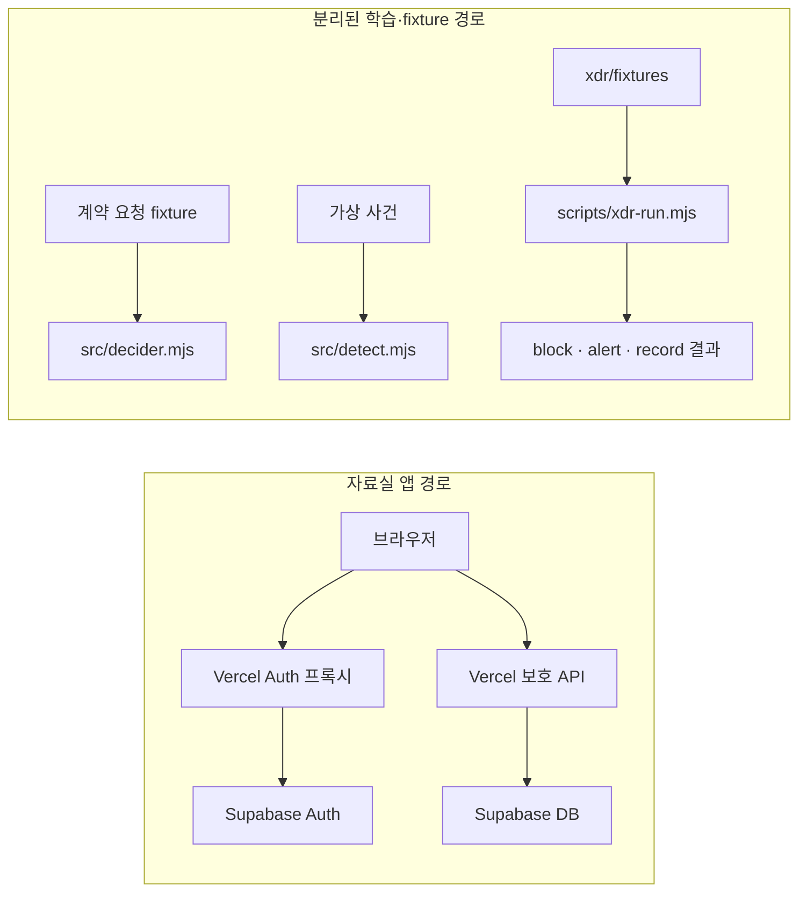

# BYTE BACK — 보안 학습·방어 프로젝트

Supabase 로그인 세션과 사용자별 자료 접근을 서버에서 확인하는 자료실 앱, 그리고 계약 판정·탐지·XDR fixture 실습 코드를 함께 다루는 학습용 저장소입니다. 코드 기준 기술은 JavaScript/Node.js 22+, Vercel Functions, Supabase Auth/Postgres, `@supabase/supabase-js`, `jose`입니다.

## 핵심 기능

- 같은 출처의 Vercel Auth 프록시를 통해 Supabase 이메일·비밀번호 로그인을 처리하고, Vercel 자료 API에서 Supabase 발급자·대상·만료와 로그인 세션을 검증합니다.
- 메모 CRUD, 강사 공지, 사용자별 백업과 단건 복구를 서버 함수로 처리합니다. 메모 API는 저장된 owner를 확인하며 공지 수정은 DB의 강사 권한을 확인합니다.
- 세션 승인 화면과 탈환 작전실을 제공합니다. 작전실은 본인 서버 요청 기록과 백업 메타데이터를 읽습니다.
- 계약 판정기, 가상 사건 탐지기, 여섯 종류의 XDR 연습은 운영 앱과 분리된 로컬 학습 경로입니다.

## 아키텍처

앱 경로에서는 서버가 검증한 Supabase 사용자와 `session_id`를 기준으로 승인 상태를 확인한 뒤 DB 자료를 처리합니다. 판정기·탐지기·XDR fixture는 이 앱 경로에 연결된 운영 방어 파이프라인이 아닙니다.

## 보안 설계와 검증 범위

- 세션 승인은 검증된 Supabase Auth 로그인 세션에 대한 서버 승인입니다. 물리 기기나 설치 앱의 소유를 증명하지 않습니다.
- 소유권·세션 승인·공지 권한 테스트는 주입된 검증기와 fixture DB를 사용합니다. A/B 교차 계정 메모 접근 거부와 세션 간 승인 비상속을 확인하는 로컬 테스트가 있습니다.
- 복구 코드는 백업의 소유자·메모 ID·내용 SHA-256을 확인하고, DB 반영 후 ID·owner·해시를 다시 검사합니다. `test/note-restore.test.mjs`는 메모리 DB fixture 검증이며 Production 복구 E2E는 저장소 기록상 미실행입니다.
- 저장소에는 실제 DB 권한 조회와 단계별 Production 확인 기록도 있습니다. 이는 기록된 시점·환경의 증거이며 현재 배포나 DB 상태를 보증하지 않습니다. 이 README 정리에서는 DB·Production을 다시 확인하지 않았습니다.

## 테스트·검증 명령

저장소에 정의된 대표 로컬 명령입니다. `npm test`와 `npm run dev` 스크립트는 없습니다.

    node --test test/*.test.mjs
    npm run decider:test
    npm run detect:test
    npm run test:stage11
    npm run test:stage12
    npm run xdr:run -- brute-force
    npm run build -- --local

Node 테스트와 판정·탐지·XDR 명령은 로컬 코드·fixture 검증입니다. `xdr:run`의 `block / alert / record`는 가상 경보에 대한 분류 결과이며 실제 트래픽 차단이 아닙니다. Production HTTP 자체 점검 스크립트는 `npm run operations:check`이며, 인증이 필요한 행은 실행하지 않고 남깁니다. 이 문서 변경 중 위 명령들은 실행하지 않았습니다.

## 로컬 실행

Node.js 22 이상과 저장소 의존성이 필요합니다. 새 학습 DB 설정, 환경변수, Vercel CLI 연결 순서는 [로컬 설정 문서](docs/LOCAL_SETUP.md)를 참고하세요. 보호 API까지 실행할 때는 정적 파일 서버 대신 연결된 Vercel CLI의 `npx vercel dev`를 사용합니다.

## 한계와 개선 방향

- 제공 ALEPH SDP 운영 엔진은 이 저장소에 포함되거나 앱 API에 연결되어 있지 않습니다. `src/decider.mjs`의 반환 판정은 운영 서비스에 실제 적용된 통제가 아닙니다.
- `detect()`는 `propose_revocation` 제안만 반환합니다. 실제 접속 회수는 수행하지 않습니다.
- XDR 입력은 수업용 fixture이며 실제 Wazuh 스트림이나 운영 트래픽 차단과 연결되어 있지 않습니다. ZTNA 게이트 결과도 fixture 실행기 안에서만 확인합니다.
- 백업 복구의 실제 Production E2E와 공식 운영 엔진 검증은 완료된 것으로 문서화되어 있지 않습니다. 개선 시 실제 엔진 연동 계약, 운영 이벤트 소스, 별도 승인된 통합 검증이 필요합니다.

## 단계 이력·상세 문서

- [기존 단계별 설명과 실행·검증 기록](docs/COURSE_HISTORY.md)
- [DB·환경변수·로컬 실행 안내](docs/LOCAL_SETUP.md)
- [12단계 작전실 설계와 실행 기록](docs/stage12-operations.md)
- [판정 요청 계약](docs/DECIDER_REQUEST.md) · [탐지 이벤트 계약](docs/DETECT_EVENTS.md) · [XDR fixture 설명](xdr/README.md)
