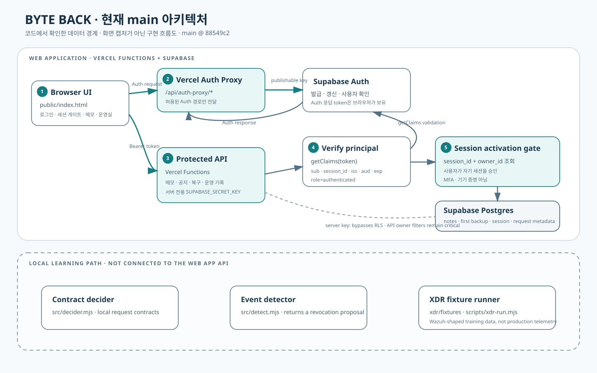

# BYTE BACK — 서버 측 인증·인가와 사용자별 데이터 보호

Supabase Auth 로그인 세션을 Vercel Functions에서 검증하고, 사용자별 메모 API를 서버에서 보호하는 보안 중심 웹 애플리케이션입니다.

**개인 구현 범위:** 세션 검증, 서버 소유권 확인, 백업·복구 경계 정리  
**기술:** JavaScript · Node.js 22+ · Vercel Functions · Supabase Auth/Postgres · `@supabase/supabase-js` · `jose`

[데모](https://choi-bujang-secret-vault-umber.vercel.app/) · [아키텍처](docs/portfolio/architecture.svg) · [상세 기술 문서](docs/portfolio/)

> 이 문서는 `main @ 88549c2`의 구현을 설명합니다. 데모·Production API·DB는 이번 문서 검토에서 열거나 실행하지 않았습니다.

## 프로젝트와 구현 결과

- **로그인·JWT 검증:** 같은 출처의 Vercel Auth 프록시를 거쳐 Supabase Auth에 로그인하고, 보호 API가 검증된 `sub`와 `session_id`를 사용합니다.
- **세션 게이트:** 현재 검증 세션의 서버 승인 상태를 확인한 뒤 보호 API에 접근합니다. 사용자가 자신의 세션을 승인하며 MFA나 물리 기기 증명은 아닙니다.
- **사용자별 메모:** 목록·조회·수정·삭제 요청을 서버 principal의 `owner_id`로 제한합니다.
- **백업·복구:** 메모의 최초 상태를 한 번 저장하고 본문 SHA-256을 확인합니다. 현재 복구의 owner 충돌·원자성 한계는 아래 기술 문서에 명시했습니다.
- **운영 기록:** 본인 요청의 경로·상태·시각 등 제한된 metadata와 백업 fingerprint를 보여줍니다.
- **분리된 학습 코드:** 계약 판정기·탐지기·XDR fixture는 로컬 실습용이며 운영 앱의 실제 탐지·차단 경로가 아닙니다.

## 아키텍처

브라우저 → Auth 프록시 → Supabase Auth → bearer token → 보호 API → JWT·세션 확인 → owner 범위 DB 요청 순으로 동작합니다. API는 서버 전용 secret/service-role key를 사용하므로 RLS를 우회할 수 있고, 사용자별 데이터 경계는 서버 owner 검사에 의존합니다.

## 구현 근거와 한계

- `getClaims` 검증과 자기 세션 승인 게이트: [인증·세션 문서](docs/portfolio/authentication-and-session.md)
- 메모 API owner 검사, RLS와 service-role 권한 경계: [인가·데이터 격리 문서](docs/portfolio/authorization-and-data-isolation.md)
- 최초 백업은 변경 버전 이력이 아닙니다. 현재 `main`의 복구는 여러 DB 요청으로 진행되며 다른 owner 행 충돌과 transaction rollback을 보장하지 않습니다: [백업·복구 문서](docs/portfolio/backup-and-recovery.md)
- 현재 생성 API는 선택적으로 client 지정 UUID를 허용합니다. 새 DB에서 API 쓰기에 필요한 service-role grant 재현성도 확인되지 않았습니다.
- Node 테스트는 verifier·fixture DB 경로를 포함하며 PostgreSQL 동시성이나 Production E2E를 대신하지 않습니다. 이번 문서 작업에서는 테스트·빌드를 실행하지 않았습니다.
- 앱 화면 캡처 파일이 저장소에 없어 가짜 이미지를 추가하지 않았습니다. 화면 구조는 [public/index.html](public/index.html)에서 볼 수 있고, 데모 주소의 현재 상태는 확인하지 않았습니다.

## 로컬 실행과 추가 문서

Node.js 22 이상이 필요합니다. DB 구성과 환경변수는 [로컬 설정](docs/LOCAL_SETUP.md), 기존 단계 기록은 [COURSE_HISTORY](docs/COURSE_HISTORY.md)를 참고하세요. 환경을 준비한 뒤 `npx vercel dev`로 Vercel Functions를 포함해 실행합니다. 정적 파일 서버만으로 보호 API를 실행할 수 없습니다. 실제 개인정보나 운영 비밀값은 입력하지 마세요.

- [시스템 아키텍처](docs/portfolio/architecture.md)
- [운영 기록·민감정보 경계](docs/portfolio/operations-and-audit.md)
- [분리된 보안 학습 모듈](docs/portfolio/learning-modules.md)
- [Stage 12 운영실 기록](docs/stage12-operations.md) · [XDR fixture 설명](xdr/README.md)
