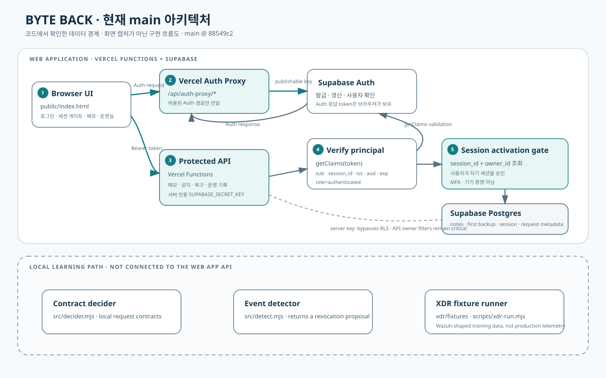

# 시스템 아키텍처

**기준 코드:** `main` @ `88549c2`  
**구성:** 브라우저 앱, Vercel Functions, Supabase Auth/Postgres, 별도 로컬 학습 모듈

## 런타임 구성

| 구성 요소 | 책임 | 코드 근거 |
| --- | --- | --- |
| 브라우저 UI | 로그인, 세션 상태 표시, 자료실·운영실 화면 | `public/index.html`, `public/auth-proxy-client.js`, `public/operations-client.js` |
| Auth 프록시 | 제한된 Auth token/user/logout 경로를 같은 출처에서 Supabase Auth로 전달 | `src/auth-proxy.mjs`, `api/auth-proxy/[...path].mjs` |
| 로그인 검증 | Supabase Auth가 검증한 학생 JWT에서 사용자와 session ID를 얻음 | `src/verify-login.mjs` |
| 세션 게이트 | 검증된 `owner_id + session_id` 승인 상태를 조회하고 API 접근을 보호 | `src/session-approval.mjs` |
| 자료 API | 메모·공지·백업·운영 메타데이터를 서버 함수에서 처리 | `src/notes-api.mjs`, `src/announcements-api.mjs`, `src/operations-api.mjs` |
| 저장소 | 메모, 최초 백업, 세션 승인, 요청 메타데이터 | `supabase/*.sql`, `supabase/migrations/*` |
| 학습 코드 | 계약 판정, 이벤트 분석, XDR 모양의 가상 경보 | `src/decider.mjs`, `src/detect.mjs`, `xdr/`, `scripts/xdr-run.mjs` |

## 요청 흐름

1. 브라우저가 제한된 Auth 프록시 경로로 로그인 요청을 보냅니다.
2. Supabase Auth 응답으로 받은 bearer token을 브라우저가 보호 API에 전달합니다.
3. API 서버가 `getClaims(token)` 결과의 발급자·대상·역할·사용자 ID·세션 ID·만료를 검증합니다.
4. 세션 게이트가 해당 `owner_id`와 `session_id` 조합의 승인 상태를 확인합니다.
5. 메모 API는 검증된 principal의 사용자 ID를 owner 조건으로 사용해 DB 요청을 처리합니다.
6. API 결과는 제한된 요청 메타데이터로 남을 수 있으며 메모 본문이나 토큰은 기록 대상이 아닙니다.

## 중요한 경계

- API는 서버 전용 `SUPABASE_SECRET_KEY`를 사용합니다. secret/service-role 경로는 RLS를 우회하므로 사용자별 접근 통제의 직접 경계는 API의 owner 검사입니다.
- `owner-policies.sql`은 authenticated 사용자에게 owner 정책을 정의합니다. `close-direct-access.sql`은 anon/authenticated의 직접 테이블·시퀀스 grant를 회수하며 RLS를 끄지 않습니다.
- 확인된 SQL은 `vault_notes`에 대해 service role의 SELECT만 명시합니다. API가 쓰기 작업을 하므로 새 DB의 실효 grant는 재현성 검증 과제로 남습니다.
- 판정기·탐지기·XDR fixture는 웹 앱의 운영 API 호출 경로로 연결되어 있지 않습니다.

## 문서화 기준

이 문서는 현재 `main`에 있는 코드만 설명합니다. 별도 작업 브랜치나 미병합 변경으로 구현된 기능은 현재 앱의 기능으로 포함하지 않습니다. 상세 경계는 [인증·세션](authentication-and-session.md), [데이터 격리](authorization-and-data-isolation.md), [백업·복구](backup-and-recovery.md), [운영 기록](operations-and-audit.md)에서 다룹니다.
